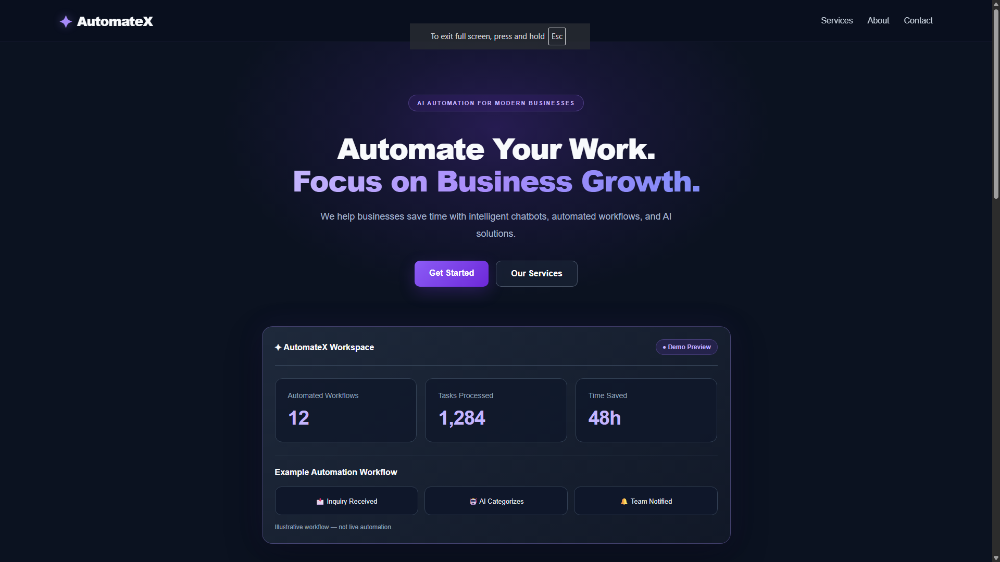
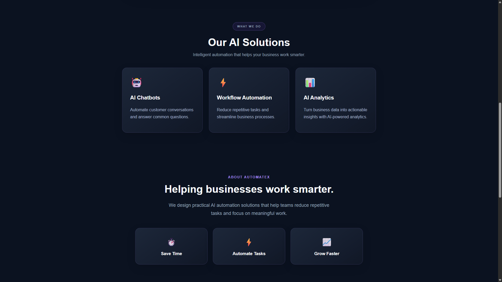
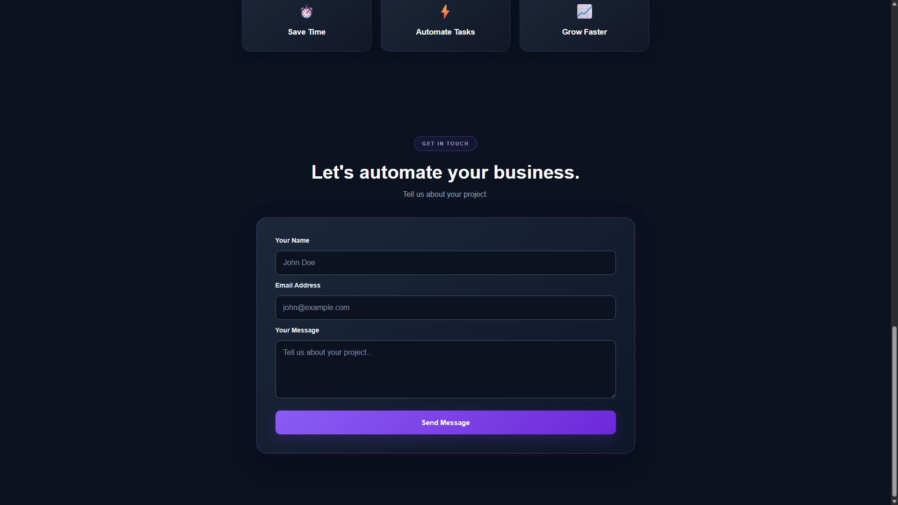
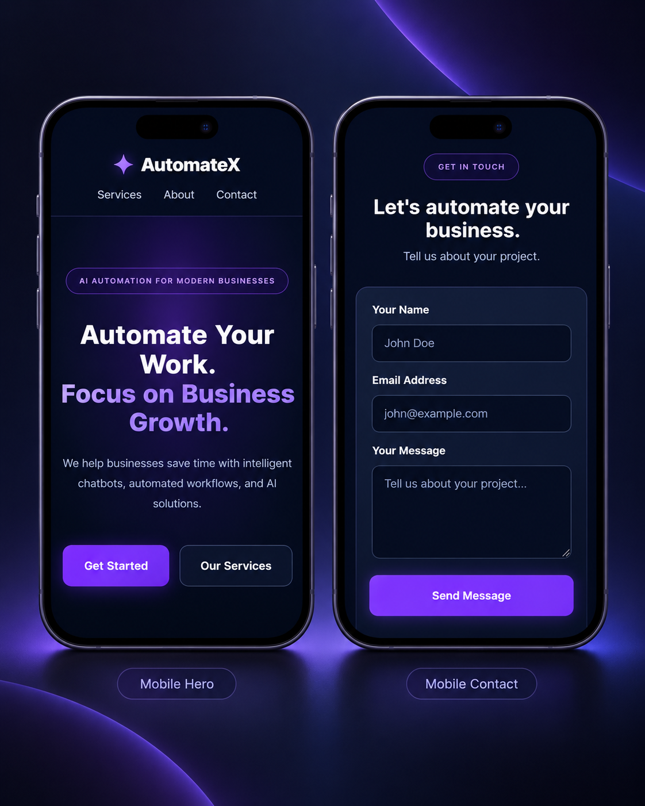
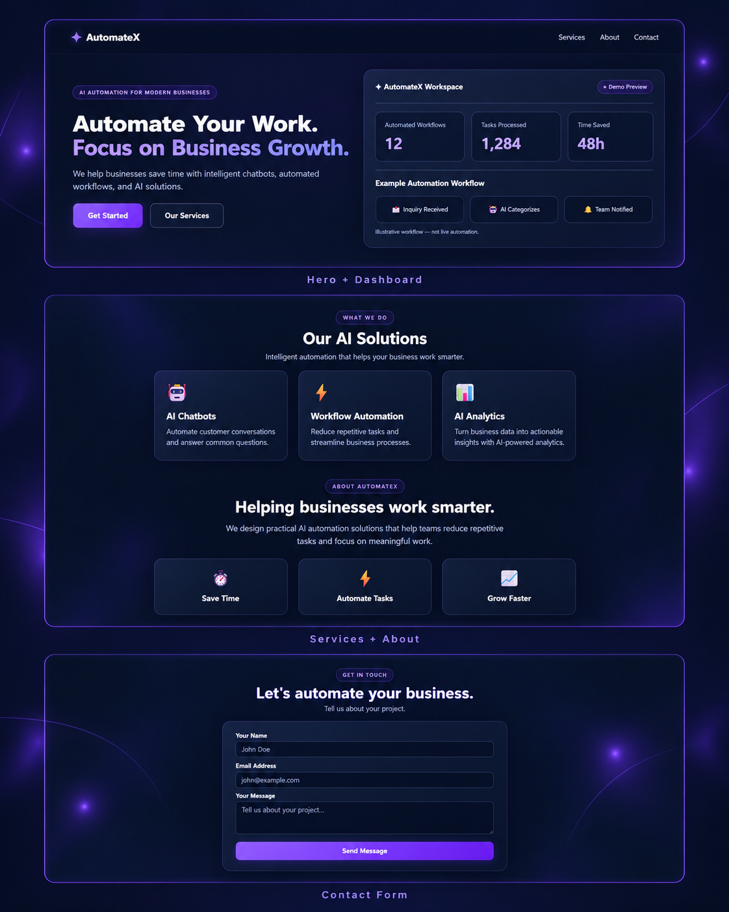

<div align="center">

# ✦ AutomateX

**A responsive website concept for an AI automation agency.**

A clean, modern interface designed to communicate services clearly, showcase a product concept, and make it easy for prospective customers to get in touch.


**[🌐 Live website](https://automatex-landings.netlify.app/)** · **[💻 Source code](https://github.com/Nijenth/automatex-landing)**

</div>

---

## The experience

**Desktop homepage — real browser screenshot**



AutomateX was created to explore how an AI services business could present a compelling digital storefront: a clear value proposition, accessible service information, a visual example of an automation workflow, and an easy way to make an inquiry.

### Key highlights

| Business-friendly feature | What visitors get |
| --- | --- |
| Clear service presentation | Straightforward descriptions of AI chatbots, workflow automation, and AI analytics |
| Responsive layout | A design adapted for desktop and phone screens |
| Illustrative dashboard | A visual explanation of what an automation workflow could look like |
| Contact form | A way to submit project inquiries through Netlify Forms on the deployed site |
| Consistent visual identity | Violet accents, dark surfaces, recognizable ✦ branding and clear calls to action |

## Desktop layouts

<table>
  <tr>
    <td width="50%" align="center"><strong>Services &amp; About</strong></td>
    <td width="50%" align="center"><strong>Contact form</strong></td>
  </tr>
  <tr>
    <td valign="top"></td>
    <td valign="top"></td>
  </tr>
</table>

## Mobile presentation

<div align="center">



<sub>Presentation mockup based on the site's mobile design, not a direct browser screenshot.</sub>

</div>

## Project showcase

<div align="center">



<sub>Editorial presentation mockup; the three desktop browser captures above show the actual implementation.</sub>

</div>

## My work

- Built a multi-section interface using reusable React components and TypeScript.
- Created responsive layouts for desktop and mobile, including navigation, service cards, and the contact form.
- Added an **illustrative** dashboard with workflow steps and clearly identified sample metrics.
- Styled interactive states, including hover feedback, keyboard/input focus treatment, and reduced-motion support.
- Integrated a contact form with Netlify's hosted form-handling workflow.
- Used Git branches to develop and merge a visual redesign, then deployed through GitHub and Netlify.

## Tech stack

| Technology | Usage |
| --- | --- |
| **React + TypeScript** | Page components and form interactions |
| **Vite** | Local development and production bundling |
| **CSS** | Styling, responsive design, transitions and layouts |
| **Netlify** | Hosting and deployed form handling |
| **Git + GitHub** | Version control and deployment workflow |

## Run locally

```bash
git clone https://github.com/Nijenth/automatex-landing.git
cd automatex-landing
npm install
npm run dev
```

Open the local URL printed by Vite (usually `http://localhost:5173/`).

**Quality checks:**

```bash
npm run lint
npm run build
```

> **Windows PowerShell:** If `npm` is blocked by your script execution policy, use `npm.cmd` in the commands above.
>
> **Contact form:** Netlify Forms processes submissions on the deployed site. A local Vite development server does not provide that endpoint.

## Project scope

This is an **independent frontend portfolio concept**, not a commissioned client project or a functioning AI automation product. The dashboard's workflow and metrics are illustrative; live chatbots, analytics processing, and automated workflows are **not** implemented.

The purpose is to demonstrate frontend development, responsive design, thoughtful presentation, form integration, and deployment.

---

<div align="center">

**✦ AutomateX** · Built as a frontend portfolio project

[View live site](https://automatex-landings.netlify.app/) · [Back to top](#-automatex)

</div>
